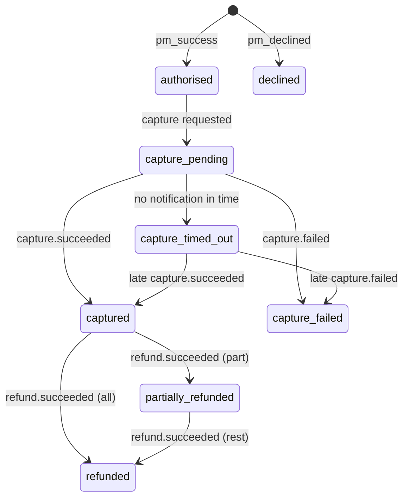

# How the API should behave

I wrote these rules before the tests. Every expected result in the collection comes from this page, so a test can't quietly decide what "correct" means.

MaxQ is a fictional online shop. Amounts are whole numbers in minor units, so `2150` in GBP means £21.50.

## Endpoints

| Method and path | What it does | Success |
|---|---|---|
| `POST /customers` | Register a customer | 201 |
| `POST /sessions` | Log in and get a bearer token | 201 |
| `POST /orders` | Create an order and work out its total | 201 |
| `POST /payments` | Authorise a payment for an order | 201 |
| `GET /payments/{id}` | Read the payment and its balances | 200 |
| `GET /payments/{id}/history` | Read the transaction history | 200 |
| `POST /payments/{id}/capture` | Ask to take the money | 202 |
| `POST /payments/{id}/refunds` | Ask to return some or all of the money | 202 |
| `POST /simulator/payment-events` | Demo only: pretend the provider sent a notification | 202 |
| `GET /simulator/deliveries/{id}` | Demo only: see how a notification was handled | 200 |

Errors look like `{ "error": { "code": "...", "message": "..." } }`.

## How a payment moves

A 202 means "request accepted", not "money moved". The money moves only when the provider's notification arrives.

## Rules

**Balances**

- `refundableMinor` = `capturedMinor` − `refundedMinor` − `pendingRefundMinor`.
- A pending refund reserves its amount straight away, so two refunds in progress can't add up to more than was captured.
- If a refund fails, its reserved amount becomes refundable again.

**Refunds**

- Allowed only once a payment is captured or part-refunded. Otherwise the response is `409 invalid_state`.
- Asking for more than `refundableMinor` gives `422 refund_exceeds_balance`.
- The amount must be a positive whole number. Otherwise the response is `400 validation_failed`.

**Notifications**

- An `eventId` takes effect once. Sending it again gives the outcome `duplicate` and changes nothing.
- A notification that doesn't fit the current state gives the outcome `rejected` and changes nothing. For example, `capture.failed` can't undo a capture that has settled.
- With no notification, a capture moves to `capture_timed_out` after 2 seconds in this demo. The timeout means "we don't know yet", not "it failed", so a late notification still counts.
- While the outcome is unknown, refunds are refused.

**Payments and orders**

- A declined payment returns 201 with the status `declined`. It can't be captured, and it doesn't stop the customer trying again.
- An order with a payment that wasn't declined can't be paid again: `409 order_already_paid`.

**Access**

- With a missing or invalid token, customer endpoints return `401 unauthenticated`.
- Another customer's payment returns `404 not_found`, not 403, so nobody can use the API to find out which IDs exist.

**History**

- Each settled capture or refund appears exactly once.
- The order of events is guaranteed. The total number of entries isn't, so the tests don't check it.

## The simulator

The simulator exists only for this demo. Set `ENABLE_SIMULATOR=false` and its routes return 404. It lets a test choose what happens next: a notification can be late, repeated, failed or never sent.

It tests how MaxQ handles those events. It doesn't prove the API would work with a real payment provider.
